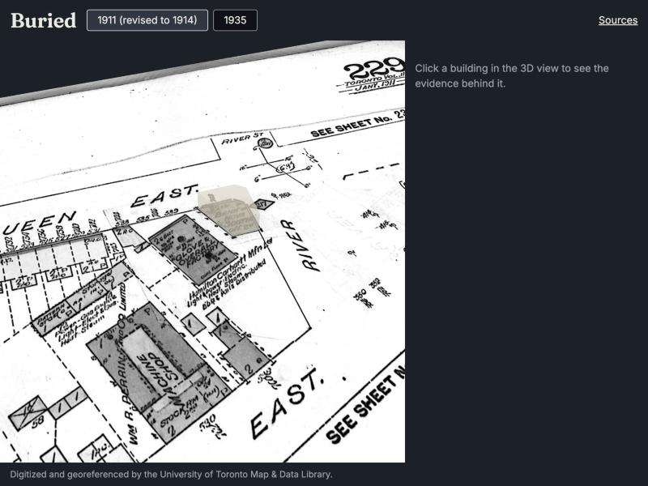

# Buried

Buried is a tool for turning archival fire insurance plans into a 3D model of a neighbourhood through
time, where every building carries the evidence behind it. The first showcase is Eastern Avenue at the
Don River, Toronto, built from Goad's Volume 3 plates (1911 and 1931, revised to 1935).

Tagline: "Forgotten maps, rebuilt with proof." Entry for Kiroween 2026.



*The one hand-traced building, a footprint read from the 1911 plate (plate 229) and extruded at runtime
by the Unity WebGL build, standing on its own drawing on the draped plate.*

## Where it stands

Status as of the go/no-go gate, 2026-11-12. Details and numbers are in `docs/gate/README.md`.

| State | What |
|---|---|
| Works today | Alignment measured on two plates (1911 and 1931-35 editions of plate 229) against six City of Toronto intersections. |
| Works today | Pipeline commands: `fetch`, `inspect`, `present`, `align-check`, `control-crops`, `validate`, `tile`. |
| Works today | The evidence schema, the Python validator, and the TypeScript date logic, era lists and `same_as` links. |
| Works today | A Unity WebGL build with one building and two eras (1911 and 1935), embedded in the web shell through a typed bridge. |
| Specified, not built | The Reconstruction Studio (spec 04) and the Report (spec 05). |
| Specified, not built | The Explorer's dusk look, ghosts, Dig, Lantern, Show Evidence, Water remembers (spec 03 beyond the gate). |
| Specified, not built | The "on this lot" test, findings and the banned-word check (spec 01 tasks 7 and 8). |
| Specified, not built | Footprint extraction, `publish` and `match`. These commands are registered and exit 2 with "not implemented yet". The 1947 aerials are not fetched. |
| Draft, awaiting review | The control points for both plates: picked by eye from 60 m crops, all in the northern two-thirds of plate 229. |
| Draft, awaiting review | The one traced building, `bld_fip_v3_1911_229_0001`, marked "gate draft, unreviewed" in its provenance. |

Measured at the gate:

| Plate | Supplied georeferencing RMSE | Worst point | Published as |
|---|---|---|---|
| 1911 (revised to 1914) | 2.140 m | 3.504 m | within about 4.3 m |
| 1931, revised to 1935 | 1.504 m | 2.607 m | within about 3.1 m |

The traced building is positioned within about 4.5 m. Switching between the two eras moves the
building and three control-point markers by 0 px, against a 2 px threshold. That check proves the
camera and projection agree across eras. It does not prove the plates sit correctly under the
markers; the two close-ups (`docs/gate/`) and the alignment numbers above are the evidence for that.
The WebGL build is 7.9 MB compressed. Test counts at the gate: web 267 (Vitest, fast-check), Unity
EditMode 54, Playwright 2, plus the pytest and Hypothesis suite in `pipeline/`.

## Run what exists

Prerequisites:

- Python 3.12 with [uv](https://docs.astral.sh/uv/).
- Node 22 or later with npm.
- Unity 6000.3.26f1 with WebGL build support. Set `UNITY_BIN` to the editor binary
  (`.../6000.3.26f1/Unity.app/Contents/MacOS/Unity` on macOS); `tools/unity.sh` exits 3 if it
  cannot find one.

Pipeline, from `pipeline/`:

```
uv sync
uv run pytest
uv run ruff check .
uv run buried validate
```

`pytest` ends with a line such as `N passed`. `ruff` prints `All checks passed!`. `validate` checks every
contract file under `data/` against the schema and exits 0, or exits 1 and lists each error.
`uv run buried fetch`, `inspect`, `present`, `align-check <SOURCE_ID>`, `control-crops <SOURCE_ID>` and
`tile` are described in `.kiro/steering/tech.md`. `fetch` writes to `data/raw/`, which is gitignored.

Web shell, from `web/`:

```
npm install
npm test
npm run typecheck
npm run build
npm run preview
```

`npm test` runs Vitest and prints a summary with no failed files (267 tests at the gate). `typecheck`
prints nothing and exits 0. `build` type-checks, then Vite prints its output files and a `built in` line.
`preview` serves the build on a local URL. The Explorer needs the Unity build below in
`web/public/unity/`; without it the page loads and the Player does not.

Unity, from the repository root:

```
tools/unity.sh exec Buried.Editor.Setup.Run
tools/unity.sh test
tools/unity.sh build
```

The first command imports packages and creates the scenes and assets; the first run takes several
minutes. Every `tools/unity.sh` call ends with `unity exit code: 0   log: unity/Logs/<mode>.log`.
`test` also prints the `<test-run ...>` line from the results file; look for `failed="0"` (54 tests at
the gate). `build` writes the WebGL build to `web/public/unity/`, which is gitignored (7.9 MB
compressed at the gate).

Gate end-to-end test, from `web/`, after the Unity build:

```
npm exec -- playwright install chromium
npm run test:e2e
```

The first command is needed once. The second builds the site, starts `vite preview`, loads the real
Unity build, and should report `2 passed`. Screenshots and pixel deltas go to `web/e2e/output/`.

## Repository layout

```
web/        Vite + React + TypeScript shell: Explorer page, Sources page, bridge (JS side), Evidence Library
unity/      Unity 6 project: runtime meshing, drape, camera, bridge (C# side and .jslib), EditMode tests
pipeline/   Python 3.12 package `buried_pipeline` and the `buried` command
data/       The contract files: schema, source registry, project origin, evidence, control points,
            alignment records, present-day layers, tiles. data/raw/ and data/work/ are gitignored.
docs/       Concept brief, Kiro session briefs, and the gate results
tools/      unity.sh, the headless Unity runner
.kiro/      Steering, specs, hooks and agent configurations
```

All stored coordinates are EPSG:26917 (metres). Longitude and latitude do not appear in evidence.

## Built with Kiro

- `.kiro/steering/`: the standing rules every session reads. Product and honesty rules, the stack and
  commands, repository layout, source rights, the evidence model and date logic, and the visual design.
- `.kiro/specs/`: five specs (evidence model, pipeline, explorer, studio, report), each with
  requirements, design and a task list. A task is ticked only after its tests pass.
- `.kiro/hooks/`: seven hook files that run validation, the banned-word tests and the bridge tests
  on save, plus a held-out-plate write guard that is disabled until the script it calls is written.
  `.kiro/hooks/README.md` says what each guards and why.
- `.kiro/agents/`: three agent configurations (architect, builder, coder) with different tools and
  permissions.
- `docs/kiro-sessions/`: the task brief given to Kiro for each session, numbered 001 to 013, including
  the one that produced this README.

The rules in `.kiro/steering/` require property-based tests (Hypothesis in Python, fast-check in
TypeScript, seeded generators in Unity EditMode). Two things they caught:

- **Precision in the alignment property.** A Hypothesis counterexample broke the property that a
  leave-one-out error is never optimistic. The check used a fixed 1e-9 tolerance, but at northings near
  4.8e6 m residuals only resolve to about 2e-9 m. The fix fits and evaluates affines relative to a local
  origin and scales the tolerance with coordinate magnitude. The property was not weakened, and the
  counterexample stays in the test as an explicit example.
- **Hole bridging in the triangulator.** The Unity ear-clipping triangulator joins each hole to the
  outer ring with a bridge. An earlier bridge leaves a vertex in the ring twice, and attaching the next
  bridge at the wrong copy made the merged ring cross itself. `OccurrenceFacing` in
  `unity/Assets/Buried/Runtime/Meshing/Triangulator.cs` picks the copy whose angle faces the hole. The
  extrusion property (E4) generates polygons with up to three holes.

The steering also requires a test that fails if any extraction fixture or parameter set references
plate 232 (1935), the held-out plate. The hook that blocks agent writes mentioning it is written but not yet enabled.

## Sources and credits

Plates:

- 1911 edition: "Digitized and georeferenced by the University of Toronto Map & Data Library."
- 1931, revised to 1935 edition: "Library and Archives Canada, National Map Collection (NMC-0013999).
  Digitized and georeferenced by the University of Toronto Map & Data Library."

1947 aerial photographs (registered in `.kiro/steering/sources.md`, none fetched yet): "1947 aerial
photographs: City of Toronto Archives. Georeferenced by the University of Toronto Map & Data Library."

Present-day layers (building outlines, property boundaries, address points, intersections):
"Contains information licensed under the Open Government Licence - Toronto."

The 1931-35 plates are photographs of the copy held by Library and Archives Canada, which carries its
own "no reproduction without permission" notice. U of T distributes the files publicly and lists the
plans as out of copyright. We rate this low risk, credit both institutions, and the maintainer has yet
to confirm it for submission.

The full licence and rights notes are in `.kiro/steering/sources.md` and on the app's Sources page.
The plates are greyscale; no material is recorded unless the plate's lettering states it.

## What Buried is not

Buried screens; it doesn't certify. Its maps are not utility locates and say nothing about present-day
soil, water or structural condition. Before you dig, request locates through
[Ontario Dig Authority](https://ontariodigauthority.ca/).

## Licence

MIT. See `LICENSE`.
