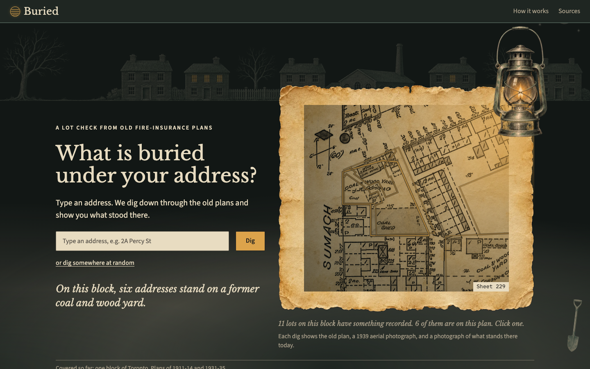
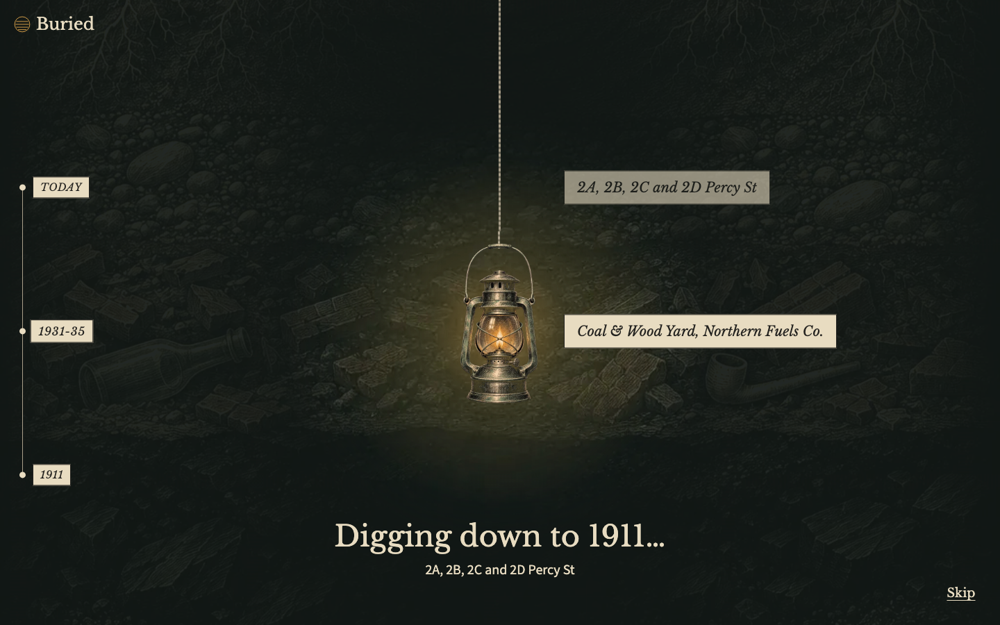
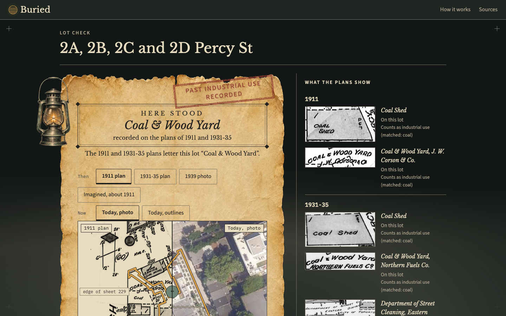

# Buried

Buried tells someone about to buy, dig or plant on an old Toronto lot what the fire-insurance plans of
1911-14 and 1931-35 lettered on that land, and shows the plan that says so.

Live site: <https://buried.pages.dev>. Tagline: "Forgotten maps, rebuilt with proof." Entry for
Kiroween 2026.



*The landing. Type an address, pick a suggestion, or click a lit lot on the plan.*



*The dig, about 4.5 seconds. At each plan's depth a paper slip shows what that plan letters on the lot.*



*The record. The lettering as the plan prints it, the stamp, and the plan against today's photograph.*

## Try it

1. Open the live site, type `2a p`, choose "2A Percy St" (it is marked "something recorded") and press
   Enter or "Dig".
2. A lantern is lowered through the plans. Skip or Escape ends it. The record opens: "HERE STOOD / Coal &
   Wood Yard", with the sentence quoting both plans and the stamp "Past industrial use recorded".
3. Drag the divider, or use the arrow keys. Switch the left side between the 1911 plan, the 1931-35
   plan, the 1939 photograph and "Imagined, about 1911". Switch the right side between today's photograph
   and today's outlines.
4. Press "Download the one-page record" for the printable Report. "Share this check" copies the link.

The dig is an animation. The lookup itself is instant.

## What it tells you, and what it does not

- **Buried screens; it doesn't certify.** It says nothing about soil, water or structures today. It is
  not a utility locate. Before you dig, request locates through
  [Ontario Dig Authority](https://ontariodigauthority.ca/).
- **The verdict is one of five tags**, decided by code from the plan's lettering: "Past industrial use
  recorded", "Industrial use recorded next to this lot", "A past use is lettered on these plans", "No
  industrial use lettered on these plans" and "Not covered yet".
- **"Industrial" comes from one short word list** in `web/src/evidence/industrialUse.ts`, matched on
  whole words. The tag always appears with the lettering that triggered it and the crop of the plan it
  was read from. The list's header says "Reviewed by: not yet".
- **"On this lot" and "next to this lot (within X m)"** follow the position-error rule in
  `.kiro/steering/evidence.md`. "Next to" uses a 30 m radius.
- **Names are the plan's lettering, quoted.** Buried never names a business or use the plan does not
  letter.
- **"No industrial use lettered" is not a clearance.** The page says so beside it.
- **Photographs and imagined views never produce a finding.** The aerial photographs (2025 and 1939) are
  for looking. The 1939 photograph is placed approximately, on the City's own caveat. The imagined views
  are made with an image model from the plans, carry "IMAGINED" in the picture, and are captioned "Not a
  photograph". A visitor has to choose one.
- **Coverage: one block of Toronto, two plans.** The block has 168 lots. On the committed data 11 get
  "Past industrial use recorded", 83 "Industrial use recorded next to this lot", 1 "A past use is lettered
  on these plans" and 73 "Not covered yet". None gets "No industrial use lettered": the reviewed areas
  attest buildings only (session 051 notes). Outside the block the page says "Not reconstructed yet."

## Where it stands

Figures are from the maintainer's own runs of Nov 25 on the deployed build. They are not a continuous
check.

| State | What |
|---|---|
| Works today | Landing, suggestions, the dig, the Result, the compare view with its layers, the "As it may have looked" postcard, the How page, the Sources page and the printable Report, at `buried.pages.dev`. They need no WebGL, work on a phone and request nothing outside the site. |
| Works today | 1,258 Vitest tests pass. The lot-check browser config passes 52 (desktop, 390 px, reduced motion, no WebGL). Pipeline pytest passes. `buried validate` is OK on 18 files and 178 features. |
| Works today | The pipeline (`fetch`, `inspect`, `present`, `align-check`, `tile`, `extract`, `publish`, `match`, `validate`), the `buried-evidence` MCP server, and the Studio on a maintainer's machine (it needs the Studio service run locally). |
| Draft | All 178 features. None has been reviewed by a named person, so every record says "draft, not yet reviewed". |
| Draft | The Industrial word list ("Reviewed by: not yet"). The landing's sentence ("On this block, six addresses stand on a former coal and wood yard.") is computed from the data and is only as good as the traced areas. |
| Draft | Control points for the plates, picked by eye in the northern two-thirds of plate 229. Position error is less certain outside their hull. |
| Parked | The raised 3D block and the walk test. Nothing on the site links to them. The Unity Player is not deployed. |
| Not built | A second block or city, 1947 imagery (two aerial records are registered, none is aligned or shown), a deployed Studio service, any claim about present-day condition. |
| Not built | A test on a real touch device. The phone passes run in Chromium at 390 px. |

Plate 232 (1931-35) is held out. No extraction setting or fixture was tuned on it.

## Built with Kiro

Every session ran through Kiro CLI. The task brief for each is in `docs/kiro-sessions/` (001 to 056).

- **Steering** (`.kiro/steering/`). Six files always or conditionally loaded. `product.md` numbers the
  honesty rules, including the banned words and the verdict rules; `design.md` holds the palette and its
  contrast pairs. In `design.md` two pairs fail (lantern on parchment, 1.6; copper on parchment, 3.0),
  so the steering bans them and a test measures every pair.
- **Specs** (`.kiro/specs/`). Eight specs, each with requirements, design and tasks. Spec 08, the lot
  check, has 12 requirements, 13 properties and 23 tasks, ticked only when tests pass.
- **Hooks** (`.kiro/hooks/`). Seven files: they validate evidence on save, check source rights, run the
  banned-word tests, regenerate the bridge types, and untick a task whose suites fail. `held-out.json`
  refuses an agent write that puts plate 232 in a tuning file. `.kiro/hooks/README.md` says what each
  guards.
- **Agents** (`.kiro/agents/`). Six, each with a narrow set of permissions. `architect` writes specs and
  steering and runs no commands. `builder` writes code and runs the allowed commands. `plate-qa` and
  `archivist` read evidence through the MCP server and never write it.
- **MCP** (`pipeline/buried_pipeline/mcp/`). `buried-evidence` is a local, read-only server over the
  committed files. It computes no dates, lot relations or confidence wording.
- **Property-based tests.** Spec 08 lists P1 to P13 marked `[PBT]`. P1: a tag of "Past industrial use
  recorded" always has a trigger whose lettering holds a list word. P4: the landing's count equals an
  independent count of address points inside the shrunk areas. P3: no generated sentence holds a banned
  word. Hypothesis and fast-check tests are written beside the pure modules.

The write-up is `docs/submission/kiro-writeup.md`; the demo script is `docs/submission/demo-script.md`.

## Run it locally

The lot check needs only the web package. From `web/`:

```
npm install
npm test
npm run typecheck
npm run dev
```

`npm test` runs Vitest with fast-check. The site reads the contract files under `data/`. To build it and
run the lot-check browser tests (no WebGL, own port 4178):

```
npm run build
npm exec -- playwright install chromium
npx playwright test -c playwright.lotcheck.config.ts
```

Screenshots go to `web/e2e/output/` (gitignored).

Pipeline, from `pipeline/` (Python 3.12 with [uv](https://docs.astral.sh/uv/)):

```
uv sync
uv run pytest
uv run ruff check .
uv run buried validate
```

The other commands (`fetch`, `inspect`, `present`, `align-check`, `tile`, `extract`, `publish`, `match`,
`manifest`) are listed in `.kiro/steering/tech.md`. `fetch` writes to `data/raw/`, which is gitignored.

The parked 3D block needs Unity 6000.3.26f1. From the repository root, `tools/unity.sh exec
Buried.Editor.Setup.Run`, `tools/unity.sh test` and `tools/unity.sh build` set up, test and build the
WebGL Player into `web/public/unity/` (gitignored). Set `UNITY_BIN` if the editor is not found.

## Repository layout

```
web/        Vite + React + TypeScript: the lot check pages, Report, Sources, Studio, Evidence Library
unity/      Unity 6 project for the parked 3D block (not deployed)
pipeline/   Python 3.12 package `buried_pipeline` and the `buried` command
data/       Contract files: schema, source registry, evidence, control points, alignment, present-day layers, tiles
docs/       Concept brief, session briefs and notes, submission documents
tools/      unity.sh, the headless Unity runner
.kiro/      Steering, specs, hooks and agent configurations
```

All stored coordinates are EPSG:26917 (metres). Longitude and latitude do not appear in evidence.

## Sources and credits

- **Plates.** Goad fire insurance plan, Volume 3, plates 229 and 232. 1911 edition (revised to 1914):
  "Digitized and georeferenced by the University of Toronto Map & Data Library." 1931 (revised to 1935)
  edition: "Library and Archives Canada, National Map Collection (NMC-0013999). Digitized and
  georeferenced by the University of Toronto Map & Data Library." U of T lists the plans as out of
  copyright. The 1931-35 photographs carry the archive's own reproduction notice, so we rate the risk low,
  credit both institutions, and the maintainer has yet to confirm it for submission.
- **Present-day layers** (building outlines, property boundaries, address points, intersections) and the
  **aerial photographs** of 2025 and 1939: City of Toronto Open Data, "Contains information licensed under
  the Open Government Licence - Toronto." The City says its historic aerial photographs were not
  orthorectified and are provided as is.
- **1947 aerial photographs** (registered, not shown): "1947 aerial photographs: City of Toronto
  Archives. Georeferenced by the University of Toronto Map & Data Library."
- **Illustrations** (lantern, earth cross-section, paper, skyline, spade) and the **imagined views** were
  made with an image model. They are decoration, not evidence, and the Sources page says so.
- **Fonts**: Libre Baskerville, Source Sans 3 and IBM Plex Mono, self-hosted, each under the SIL Open Font License 1.1.

Full licence and rights notes: `.kiro/steering/sources.md` and the Sources page. The plates are greyscale;
no material is recorded unless the plan's lettering states it.

## Licence

MIT. See `LICENSE`.
