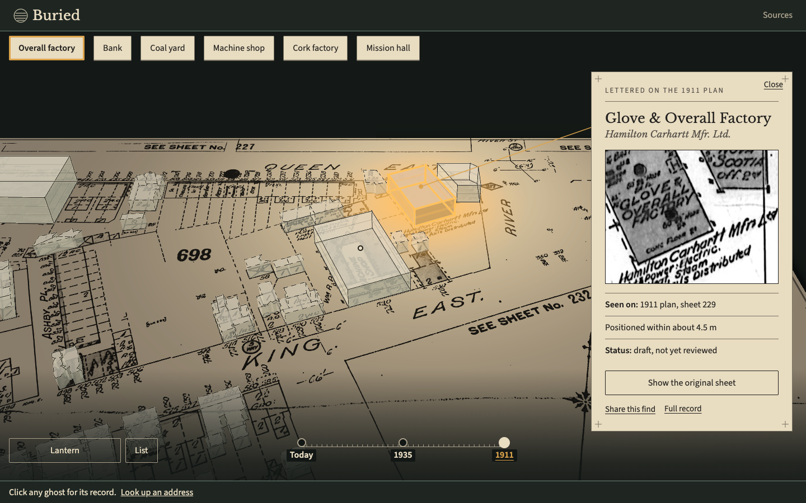

# Buried

Buried is a tool for turning archival fire insurance plans into a 3D model of a neighbourhood through
time, where every building carries the evidence behind it. The first showcase is Eastern Avenue at the
Don River, Toronto, built from Goad's Volume 3 plates (1911 and 1931, revised to 1935).

Tagline: "Forgotten maps, rebuilt with proof." Entry for Kiroween 2026.

Live site: <https://buried.pages.dev>. Press "Raise the past" and the 1911 plan's buildings stand up
on the block, each with the lettering it was read from.



*The first visit after "Raise the past". The 1911 plan lies on a dark table, its buildings stand as
ghosts, and the Glove & Overall Factory is selected: its lettering crop, the plan it was seen on,
how closely it is placed, and a status line that says "draft, not yet reviewed".*

## Where it stands

Status is read from the repository as of the last commit to this file. The go/no-go gate results
are in `docs/gate/README.md`. The first visit was rebuilt on Nov 13 (sessions 037 to 046).

| State | What |
|---|---|
| Works today | The first visit at `buried.pages.dev` (`/`): the block on a dark table with today's buildings as soot blocks, a headline, and one button, "Raise the past". Pressing it sinks today's buildings to a thin outline and stands up the 1911 plan's published buildings as ghosts. A still picture of the scene shows first while the Unity Player loads. |
| Works today | Six finds (`data/finds.json`: overall factory, bank, coal yard, machine shop, cork factory, mission hall), each with the lettering crop it was read from. Selecting one opens a catalogue card (a bottom sheet on a phone): the name as lettered, the crop, the plan it was seen on, "Positioned within about X m", a status line, "Show the original sheet", "Share this find" and "Full record". Find tags sit along the top, and any ghost can be clicked. |
| Works today | The era ruler (Today, 1935, 1911). On a selected find it adds one line saying what the other plan letters there, for example the coal yard under J. W. Corson & Co. on the 1911 plan and Northern Fuels Co. on the 1931-35 plan. |
| Works today | The Lantern: a round lens, dragged with a pointer or a finger, that shows the other layer inside it. |
| Works today | Share links: `/find/<slug>` opens raised on that find. |
| Works today | Without WebGL, or if the Player fails, a flat sheet drawn by the web shell: the plate tile with the published outlines, and the same tags, card, ruler, lens and share link. |
| Works today | Beyond the first visit: the place page (`/place` for address search, `/place?lot=...` for the dig and the report of one lot), reached from "Look up an address"; the Report (`/report`, with a one-page print layout), reached from "Full record"; the Sources page (`/sources`, which also links the Studio); and the Explorer (`/explorer`). The Report gives findings with status labels, "on this lot" and "near this lot" tests, a coverage statement and the list of records checked. |
| Works today | The Studio slice (`/studio`, linked from the Sources page, not the header): fetch a registered plate, extract footprints, review them one by one, trace a land-use area from a plate's lettering, publish into the workspace, and export a bundle for the maintainer to review. It needs the Studio service running on the maintainer's machine. |
| Works today | Pipeline commands: `fetch`, `inspect`, `present`, `align-check`, `control-crops`, `tile`, `extract`, `publish`, `match`, `validate`, `manifest`. `extract` is deterministic image processing; `publish` writes only what a person accepted. |
| Works today | The `buried-evidence` MCP server (`pipeline/buried_pipeline/mcp`, registered in `.kiro/settings/mcp.json`) and the two agents that read it: `archivist` (sources, rights) and `plate-qa` (what a reviewer should look at). `find_places` returns finds with their review state. The held-out-plate write hook is enabled. |
| Draft | All 175 published features, in two evidence files. Evidence schema 1.2.0 records a review state for each: 13 are draft by hand (the bank and twelve tracings of the named places on both plans) and 162 are draft by rule. None is reviewed, so every card says "Status: draft, not yet reviewed". Eight rule-drawn fragments were merged into the hand tracings. |
| Draft | The six finds and their eleven readings: the lettering and the crops were transcribed by the maintainers and have not been reviewed. |
| Draft | The control points for both plates, picked by eye from 60 m crops, all in the northern two-thirds of plate 229, and the map areas, set once by hand. |
| In progress | Five older browser tests failed after the Nov 13 merge. Three expected the old journey, one was the land-use failure seen from the Studio suite, and one was real: the confidence line patterns in the 3D scene no longer differed after the look pass. Session 045 reports the land-use and card-sync tests fixed. Session 046 was assigned the rest and has not reported. |
| Not built | Studio Align and editing: the Studio does not yet let you place control points or edit footprints. Merge and split traces are refused. |
| Not built | 1947 imagery. Two aerial records are registered in `data/sources.json`, but neither has an alignment record, so neither is tiled or shown, and 1947 is not on the era ruler. |
| Not built | A deployed Studio service. The site is static; extract and publish need the service run locally. |
| Not built | Water remembers: no water source has been chosen. |

Measured at the gate (plate 229, against six City of Toronto intersections):

| Plate | Supplied georeferencing RMSE | Worst point | Published as |
|---|---|---|---|
| 1911 (revised to 1914) | 2.140 m | 3.504 m | within about 4.3 m |
| 1931, revised to 1935 | 1.504 m | 2.607 m | within about 3.1 m |

Alignment is measured only at the control points. The alignment record states their hull, and a
position error is less certain outside it, which includes the southern third of plate 229. The
held-out plate (232, 1931-35) has not been published.

Measured on the merged build of Nov 13: 1,032 Vitest tests pass; the first visit against the real
Player (`playwright.block.config.ts`) passes 9 of 9; with no WebGL (`playwright.blockflat.config.ts`)
5 of 5; the hosting config 17 of 17; Unity EditMode 218 of 218; `buried validate` is OK on 18 files
and 175 features; the pipeline test suite passes. These are the maintainer's own runs, not a
continuous check.

## Run what exists

Prerequisites:

- Python 3.12 with [uv](https://docs.astral.sh/uv/).
- Node 22 or later with npm.
- Unity 6000.3.26f1 with WebGL build support. Set `UNITY_BIN` to the editor binary
  (`.../6000.3.26f1/Unity.app/Contents/MacOS/Unity` on macOS); `tools/unity.sh` exits 3 if it
  cannot find one.

Pipeline, from `pipeline/`:

```
uv sync
uv run pytest
uv run ruff check .
uv run buried validate
```

`pytest` ends with a line such as `N passed`. `ruff` prints `All checks passed!`. `validate` checks every
contract file under `data/` against the schema, including `data/finds.json`, and exits 0, or exits 1 and
lists each error. `uv run buried fetch`, `inspect`, `present`, `align-check <SOURCE_ID>`,
`control-crops <SOURCE_ID>`, `tile`, `extract`, `publish`, `match` and `manifest` are described in
`.kiro/steering/tech.md`. `fetch` writes to `data/raw/`, which is gitignored.

Web shell, from `web/`:

```
npm install
npm test
npm run typecheck
npm run build
npm run preview
```

`npm test` runs Vitest and prints a summary with no failed files. `typecheck`
prints nothing and exits 0. `build` type-checks, then Vite prints its output files and a `built in` line.
`preview` serves the build on a local URL. The 3D scene needs the Unity build below in
`web/public/unity/`; without it the page loads and shows the flat sheet.

Unity, from the repository root:

```
tools/unity.sh exec Buried.Editor.Setup.Run
tools/unity.sh test
tools/unity.sh build
```

The first command imports packages and creates the scenes and assets; the first run takes several
minutes. Every `tools/unity.sh` call ends with `unity exit code: 0   log: unity/Logs/<mode>.log`.
`test` also prints the `<test-run ...>` line from the results file; look for `failed="0"`. `build`
writes the WebGL build to `web/public/unity/`, which is gitignored.

The first visit's browser tests, from `web/`, after `npm run build`:

```
npm exec -- playwright install chromium
npx playwright test -c playwright.blockflat.config.ts
npx playwright test -c playwright.block.config.ts
```

The first command is needed once. `playwright.blockflat.config.ts` runs the no-WebGL path and needs no
Unity build. `playwright.block.config.ts` runs the `@unity` specs against the real Player, so it needs
the Unity build in `web/public/unity/`, and run `npm run build` again after every Unity build. Screenshots
go to `web/e2e/output/` (gitignored). The older gate test is `npm run test:e2e`.

The still picture the landing shows first is rendered by Unity from the scene the web shell builds.
From the repository root:

```
npm --prefix web run gen:still-scene
tools/unity.sh exec Buried.Editor.Setup.Run
tools/unity.sh exec Buried.Editor.Still.Render
```

This writes `web/public/still/block-wide.jpg`, `block-tall.jpg` and `block.json`. The render needs a
graphics device, so it does not run on a machine with no display. Run it again when `data/finds.json` or
the evidence changes, or the tags on the still keep stale positions. Do not commit
`unity/Assets/Buried/Scenes/Bootstrap.unity` or the `ProjectSettings` files that `Setup.Run` touches.

## Repository layout

```
web/        Vite + React + TypeScript shell: the first visit (block page), place page, Explorer, Studio, Report, Sources, bridge (JS side), Evidence Library
unity/      Unity 6 project: runtime meshing, drape, camera, lamp and ghost look, bridge (C# side and .jslib), EditMode tests
pipeline/   Python 3.12 package `buried_pipeline` and the `buried` command
data/       The contract files: schema, source registry, project origin, evidence, finds, control points,
            alignment records, present-day layers, tiles. data/raw/ and data/work/ are gitignored.
docs/       Concept brief, Kiro session briefs, and the gate results
tools/      unity.sh, the headless Unity runner
.kiro/      Steering, specs, hooks and agent configurations
```

All stored coordinates are EPSG:26917 (metres). Longitude and latitude do not appear in evidence.

## Built with Kiro

- `.kiro/steering/`: the standing rules every session reads. Product and honesty rules, the stack and
  commands, repository layout, source rights, the evidence model and date logic, and the visual design.
- `.kiro/specs/`: six specs (evidence model, pipeline, explorer, studio, report, first visit), each with
  requirements, design and a task list. A task is ticked only after its tests pass. The sixth was written
  after an outside review and the maintainer's own verdict that the first visit was unclear, and its tasks
  were built in three groups (web, Unity, pipeline) at the same time.
- `.kiro/hooks/`: seven hook files that run validation, the banned-word tests and the bridge tests
  on save, plus a write guard for the held-out plate. `.kiro/hooks/README.md` says what each guards
  and why.
- `.kiro/agents/`: six agent configurations. `architect` writes specs, `builder` and `coder`
  implement tasks, `mechanic` makes small edits, and `archivist` and `plate-qa` read the evidence
  files through the MCP server and write notes, never evidence.
- `docs/kiro-sessions/`: the task brief given to Kiro for each session, numbered 001 to 047,
  including the one that produced this README.
- Contracts shared by the three lanes: the bridge between the web shell and Unity is at version 0.8.0
  (`data/schema/bridge.schema.json`), the evidence schema is 1.2.0 (it adds a review state to every
  feature), and `data/finds.json` lists the six finds with their lettering crops.

The rules in `.kiro/steering/` require property-based tests (Hypothesis in Python, fast-check in
TypeScript, seeded generators in Unity EditMode). Things they caught:

- **Precision in the alignment property.** A Hypothesis counterexample broke the property that a
  leave-one-out error is never optimistic. The check used a fixed 1e-9 tolerance, but at northings near
  4.8e6 m residuals only resolve to about 2e-9 m. The fix fits and evaluates affines relative to a local
  origin and scales the tolerance with coordinate magnitude. The property was not weakened, and the
  counterexample stays in the test as an explicit example.
- **Hole bridging in the triangulator.** The Unity ear-clipping triangulator joins each hole to the
  outer ring with a bridge. An earlier bridge leaves a vertex in the ring twice, and attaching the next
  bridge at the wrong copy made the merged ring cross itself. `OccurrenceFacing` in
  `unity/Assets/Buried/Runtime/Meshing/Triangulator.cs` picks the copy whose angle faces the hole. The
  extrusion property (E4) generates polygons with up to three holes.
- **A generator that was wrong, not the code.** The property that published land-use areas never reach
  outside the map area failed on a small area well inside it. `publish` was right to refuse it: the test's
  helper attached a lettering crop that ran off the plate. The generator now builds a crop equal to the
  area, and the counterexample stays as an explicit example.

The steering also requires a test that fails if any extraction fixture or parameter set references
plate 232 (1935), the held-out plate. The hook that blocks agent writes mentioning it is enabled.

## Sources and credits

Plates:

- 1911 edition: "Digitized and georeferenced by the University of Toronto Map & Data Library."
- 1931, revised to 1935 edition: "Library and Archives Canada, National Map Collection (NMC-0013999).
  Digitized and georeferenced by the University of Toronto Map & Data Library."

1947 aerial photographs (registered in `data/sources.json` and `.kiro/steering/sources.md`, none shown): "1947 aerial
photographs: City of Toronto Archives. Georeferenced by the University of Toronto Map & Data Library."

Present-day layers (building outlines, property boundaries, address points, intersections):
"Contains information licensed under the Open Government Licence - Toronto."

The 1931-35 plates are photographs of the copy held by Library and Archives Canada, which carries its
own "no reproduction without permission" notice. U of T distributes the files publicly and lists the
plans as out of copyright. We rate this low risk, credit both institutions, and the maintainer has yet
to confirm it for submission.

The full licence and rights notes are in `.kiro/steering/sources.md` and on the app's Sources page.
The plates are greyscale; no material is recorded unless the plate's lettering states it.

## What Buried is not

Buried screens; it doesn't certify. Its maps are not utility locates and say nothing about present-day
soil, water or structural condition. Before you dig, request locates through
[Ontario Dig Authority](https://ontariodigauthority.ca/).

## Licence

MIT. See `LICENSE`.
